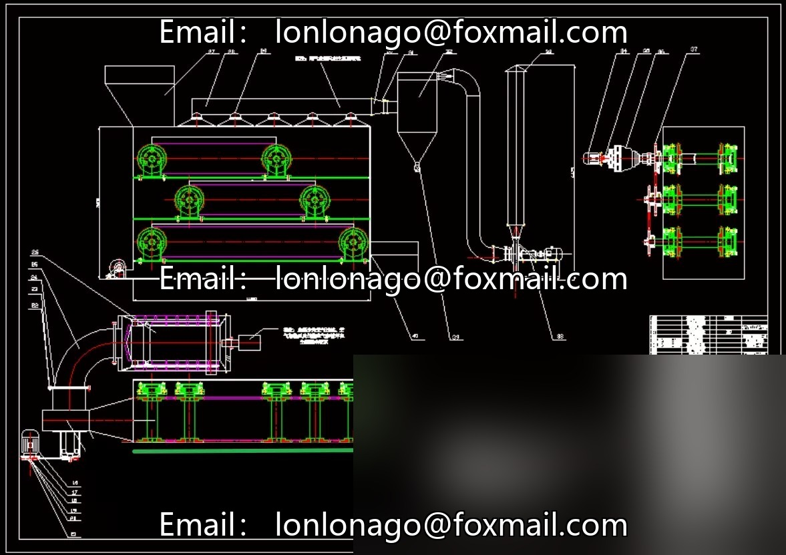
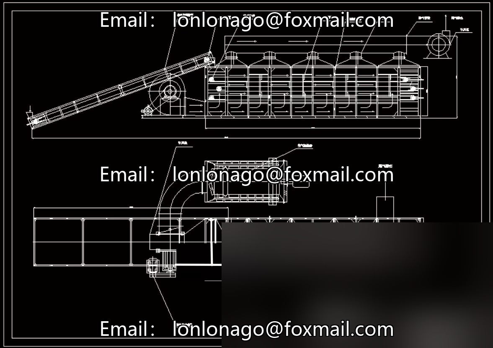
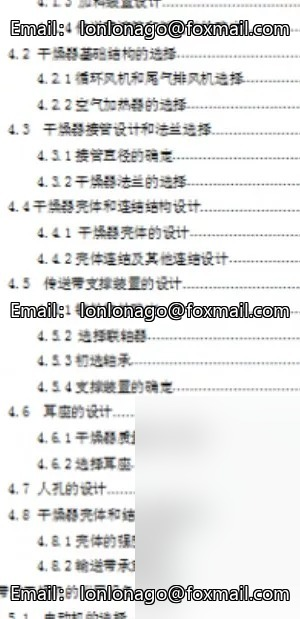
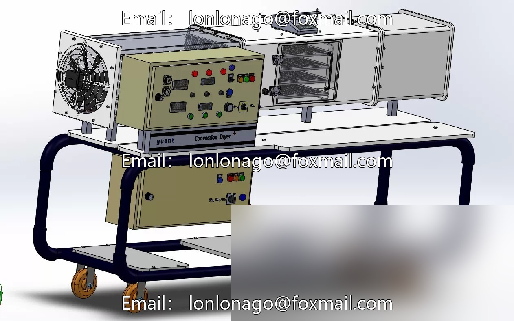
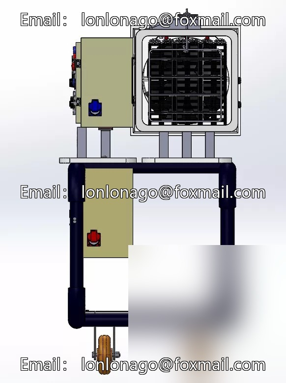

# Pulverized dryer design; Pulverized dryer diagram; Pulverized dryer design diagram; Pulverized dryer design

## Body

Wide belt dryer design; Wide belt dryer drawing; Wide belt dryer design drawing; Wide belt dryer design CAD drawing
185 This is the wide belt dryer, and its design includes the wide belt dryer, determines the process flow, dry gas, process calculation, structural calculation and design of the dryer, and selects the supporting equipment.
    An additional 3D drawing is provided

The design covers the process flow, drying gas, process calculations, dryer structural calculation, and equipment selection for a belt dryer, with a three-dimensional figure also provided.

<!-- AI_ENRICHED -->

## Images

## Payment

Here is a pay link on Stripe ( https://buy.stripe.com/3cs8yP7sY87d0vu9AB ). Please contact me lonlonago@foxmail.com after funding $89, and I will send you a complete data files , thank you!

